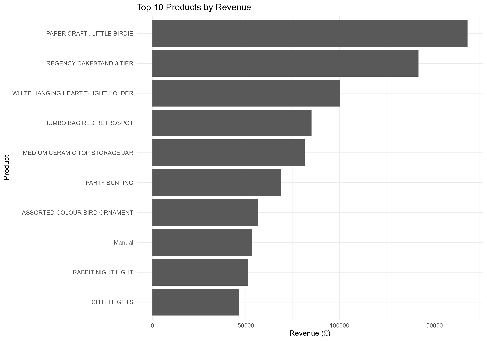
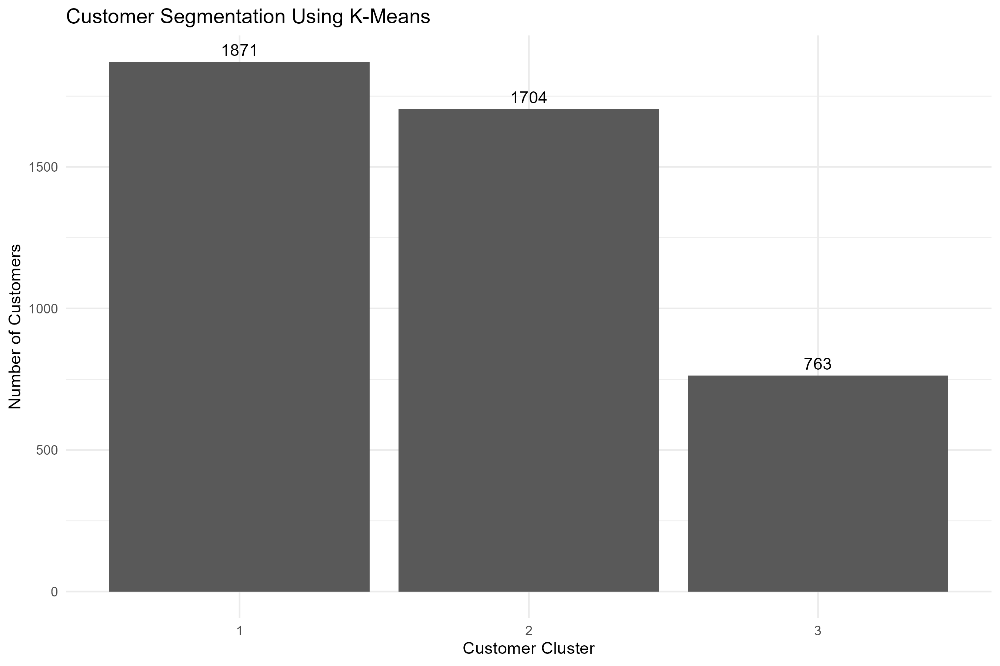
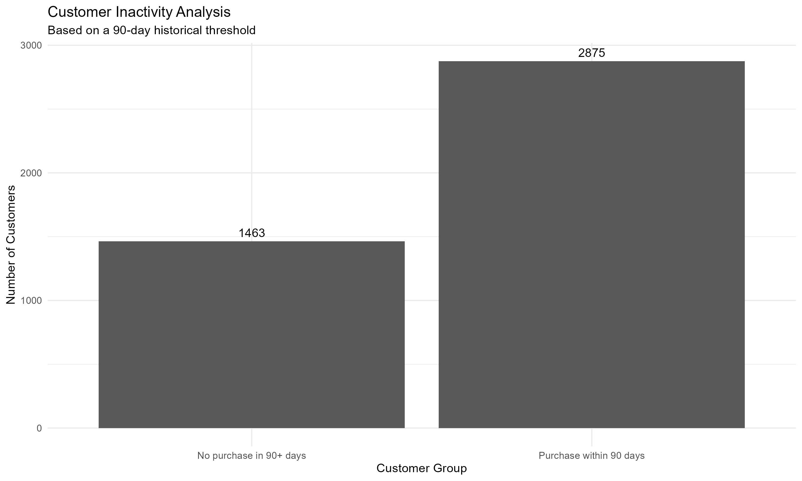
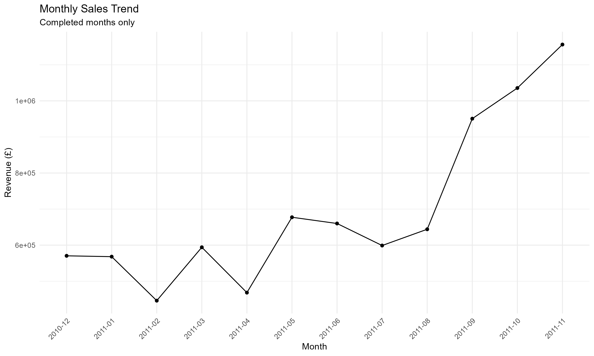
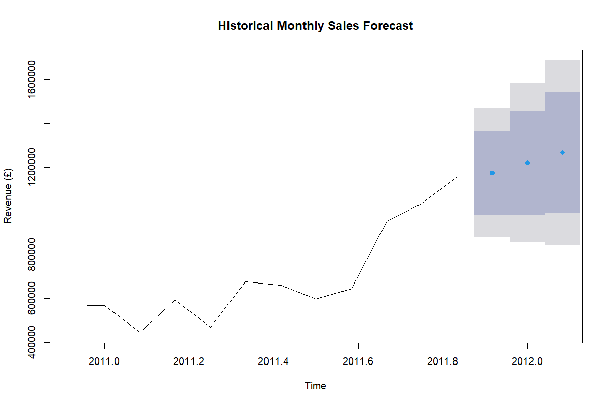
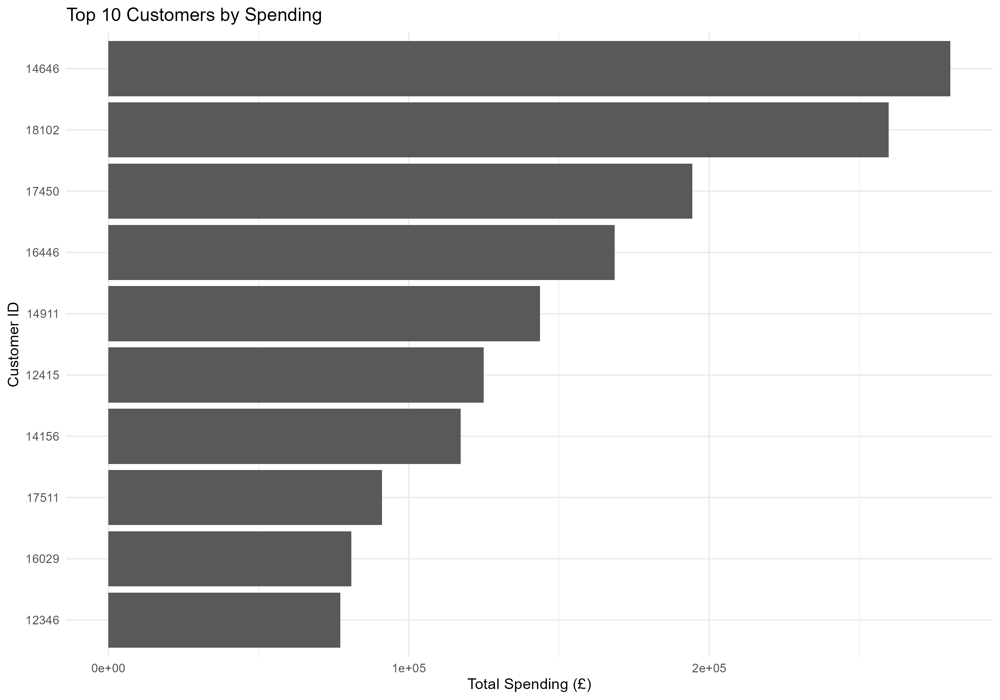
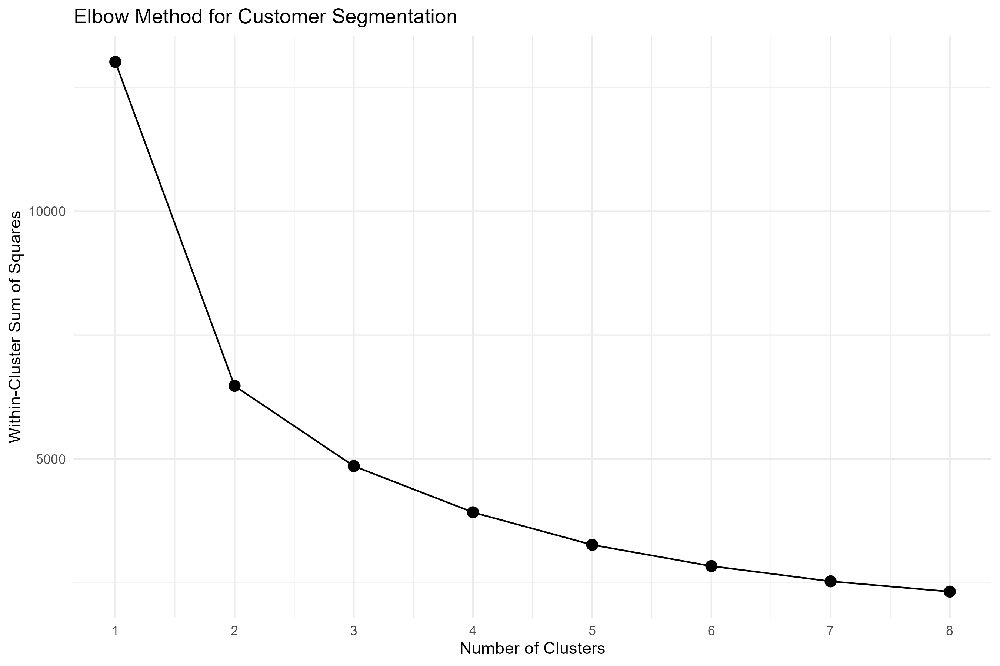

 Project Visualizations

The following visualizations were generated using R and ggplot2.

 1. Top 10 Products by Revenue

2. Customer Segmentation Using K-Means

 3. Customer Inactivity Analysis

 4. Monthly Sales Trend

5. Historical Sales Forecast

6. Top 10 Customers by Spending

 7. Elbow Method for Customer Segmentation

 ⚠️ Dataset Note

This project uses historical e-commerce transaction data from December 2010 to December 2011. The findings and forecasts are based on that historical period and should not be interpreted as current business results.
